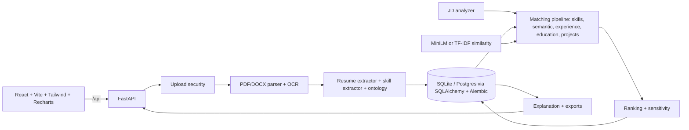

# TalentIQ AI — Evidence-Driven Recruitment Intelligence

Upload resumes (PDF/DOCX), describe a job, and get a **ranked, explainable shortlist** where every score points back to the exact resume text that justifies it. It is **decision support**: it never auto-rejects anyone and a recruiter makes every decision.

Runs fully offline on a CPU-only laptop (8 GB RAM). No paid APIs, no LLM, no Ollama.

> **Honest status.** This is a student/portfolio-grade project, tested on **synthetic** data only. It has **not** been validated on real resumes, has no independent annotation, and is **not** production-ready. See [Known limitations](#known-limitations) and [docs/AUDIT_REPORT.md](docs/AUDIT_REPORT.md).

## What it does

| Area | Implementation |
|---|---|
| Resume parsing | PDF (PyMuPDF, pdfplumber fallback, two-column reading order, optional Tesseract OCR) and DOCX (headings, layout tables). Name/contact, sections, employment, education, projects, certifications, skills — each with page + source line. |
| Job analysis | Extracts requirements, must-have vs preferred, "X or Y" alternatives, min/preferred years, education level, responsibilities, domains. Fully editable before saving. |
| Matching | Hybrid score (below), skill ontology with synonyms and related-skill partial credit, semantic similarity (all-MiniLM-L6-v2 sentence embeddings, run in pure NumPy when torch is unavailable; TF-IDF only as a labelled fallback). |
| Evidence | Every snippet is a **verbatim substring** of the resume text. Unverifiable snippets are discarded, never invented. |
| Explainability | Per-component points, matched/related/missing skills, "why / why not", missing-information list, score range when evidence is absent. |
| Recruiter tools | Filters, sort, pagination, compare up to 5, notes, status, saved searches, manual override **with required reason** (machine score is never rewritten), what-if simulation, CSV/Excel/PDF reports. |
| Pipeline & discovery | **Pipeline board**: drag candidates across New / Reviewed / Shortlisted / Interview / On hold / Not progressing, with Undo (every move is a recruiter decision and is audit-logged; nothing moves automatically). **Talent matrix**: every candidate scored against every job as a heatmap, with best fit per person, a "most versatile" insight and a top pick per job, with **Export Excel** (heatmap-coloured workbook of exactly what is on screen: filters, sort and blind mode; contact details are never included). **Ctrl/Cmd+K command palette** to jump to any page, job or candidate. **Bulk shortlist** on the Ranking page: tick candidates (or "select all on page" / "select all ≥ 70"), then Shortlist or move them to any stage in one atomic, audit-logged request, with Undo. **Interview notes** on every candidate: structured scorecards (round, date, interviewer, 1–5 stars for technical / communication / problem solving / collaboration, recommendation, strengths, concerns, notes) with an average rating and a tally of what interviewers said (also shown as an "N interviews · ★ avg" chip on Pipeline cards and as a section of the candidate PDF report; the PDF leaves them out in blind-screening mode, and `?interviews=false` omits them). The ranking Excel gets an **Interviews** sheet (one row per scorecard) plus "Interviews" / "Interview avg rating" columns, and the ranking CSV and the Talent matrix Excel get the same two summary columns (numbers only, never text); all of them leave interviews out in blind mode or with `?interviews=false`. They are human opinions: they never change the match score or rank, there is no combined verdict, they are erased with the candidate, and the audit log records ids only, never note text. Toast notifications for actions. |
| Fairness & privacy | Protected-attribute lines scrubbed before matching, blind-screening mode, twin-resume test, PII-free audit log, candidate deletion, retention purge. |
| Security | Magic-byte checks, size/page/zip-bomb limits, active-content PDF rejection, macro rejection, random storage names, prompt-injection flagging, optional API key, CSV formula-injection protection. |

### Scoring formula

```
Overall = 0.40·Technical + 0.25·Semantic + 0.20·Experience + 0.10·Education + 0.05·Project/Domain
```
Weights are configurable (must sum to 100 %). Components a job does not require are dropped and the rest are renormalised. Missing candidate evidence scores 0 but **widens the score range** (shown as e.g. `62–75`) instead of being treated as a mismatch. Details: [docs/AI_MATCHING_ALGORITHM.md](docs/AI_MATCHING_ALGORITHM.md).

### Architecture



## Quick start (Windows PowerShell)

Prerequisites: Python 3.11+, Node 20+ (tested with Node 22). Optional: [Tesseract](https://github.com/UB-Mannheim/tesseract/wiki) for scanned PDFs.

```powershell
# 1. Backend
cd backend
python -m venv .venv
.\.venv\Scripts\Activate.ps1
pip install -r requirements-dev.txt
python ..\scripts\fetch_minilm.py   # one time, about 90 MB: the sentence-embedding model (hash-verified). Without it the app uses TF-IDF and says so
alembic upgrade head          # optional: the app also creates tables on startup
python -m uvicorn app.main:app --reload --port 8000

# 2. Frontend (new PowerShell window)
cd frontend
npm install
npm run dev                    # http://localhost:5173
```

**PostgreSQL (recommended, as the assignment prefers).** `.\scripts\setup_postgres.ps1` installs a portable PostgreSQL 16.4 into `~	alentiq-pg` (no admin rights); after that `.\start.ps1` starts it on port 5433, creates the `talentiq` database and runs the app on it. Without it the app falls back to SQLite. On a machine whose Application Control blocks the `psycopg` binary wheel, `start.ps1` sets `PSYCOPG_IMPL=python` and uses PostgreSQL's own `libpq.dll`.

Open http://localhost:5173 → **Dashboard → Load synthetic test data** → **Jobs → Rank** on a template job → **Run matching**. API docs: http://localhost:8000/api/docs.

**Semantic matching.** The semantic component uses the sentence-embedding model all-MiniLM-L6-v2. `python scripts/fetch_minilm.py` downloads it once (about 90 MB, every file checked against the hash Hugging Face publishes) into `backend/storage/models/`. The app runs it with `sentence-transformers` when that is installed, and otherwise with its own **pure-NumPy implementation of the same model** (`backend/app/services/minilm_numpy.py`: same weights, same WordPiece tokenizer, mean pooling, 256-token limit; no torch needed, so it works on any Python version and on locked-down machines). `EMBEDDING_BACKEND=auto` (the default) uses MiniLM when the model files exist and otherwise falls back to TF-IDF, and the ranking page says which one was used and why. `EMBEDDING_BACKEND=tfidf` forces TF-IDF, `minilm` insists on MiniLM.

Regenerate the synthetic sample data (fictional people, testing only): `python scripts/generate_sample_data.py` from the repo root.

### Tests

```powershell
cd backend ; python -m pytest -q          # backend suite
cd ..\frontend ; npm test                 # component/unit tests
cd ..\backend ; python eval\run_evaluation.py --backend minilm --tag mine  # benchmark (use --backend tfidf to compare)
```
See [docs/TESTING.md](docs/TESTING.md) for what each suite covers and the latest recorded results.

### 50-resume test pack (2026-11-16)
A separate pack of 50 fictional PDF resumes with an answer key (5 intended profile groups of 10, one AI/ML JD) was run through the real UI on an empty database: JD pasted and saved, all 50 PDFs attached through the file chooser, matching run with MiniLM.

| Check | Result |
|---|---|
| Upload | 50 parsed, 0 failed, 0 duplicates (about 1 s) |
| Matching | 50 candidates ranked in 6.6 s (MiniLM, NumPy runtime) |
| "Strong match" group (10) | **all 10 in the top 10**; every one ranked above every Good-with-gaps, Backend/API, ML-focused and Adjacent/weak candidate |
| Other groups vs "Adjacent/weak" | only 75 % of (partial, weak) pairs are ordered correctly; the best "Adjacent/weak" resume ranks 13th and scores 79.7 |
| Experience years vs the key | within 1 year for 39 of 50 resumes (mean absolute difference 0.85 y) |
| Skill extraction vs the key's skill lists | recall 0.94, precision 0.73 (the app also extracts skills such as Agile that the key does not list, so precision is partly the key being short) |

Honest notes: the first run ranked three "Strong match" resumes 24th, 28th and 30th because a role titled "Machine Learning Engineer" was not treated as relevant to an "AI/ML Engineer" job (0 relevant years). That was fixed (title abbreviations are normalised, regression test added) and the numbers above are from the run after the fix, so the fix was made on this same pack. The pack is synthetic and its key is "intended profile", not a human judgement of fit.

### Configuration
Environment variables only (no `.env` auto-loading) — see [.env.example](.env.example). Set `API_KEY` for any shared deployment. `EMBEDDING_BACKEND` defaults to `auto` (options: `auto | minilm | tfidf`); `EMBEDDING_MODEL_DIR` points at the model files (default `backend/storage/models/all-MiniLM-L6-v2`).

## Documentation
[Architecture](docs/ARCHITECTURE.md) · [Matching algorithm](docs/AI_MATCHING_ALGORITHM.md) · [API](docs/API_DOCUMENTATION.md) · [Testing](docs/TESTING.md) · [Security](docs/SECURITY.md) · [Demo script](docs/DEMO_SCRIPT.md) · [Audit report](docs/AUDIT_REPORT.md) · [Checklist](docs/CHECKLIST.md) · [Interview prep](interview_prep/)

## Known limitations
- **PDF fonts:** the PDF reports use bundled Noto Sans + Noto Sans Devanagari (SIL OFL, see `backend/app/assets/fonts/`), so Hindi in names, resume evidence and interview notes is shaped correctly (needs the `uharfbuzz` package; without it Hindi is drawn unshaped). Arabic, Chinese, Japanese and emoji have no bundled font and appear as `?`. A Hindi word glued to Latin text without a space gets a space inserted in the PDF (a reportlab limitation: a space-free word is drawn with one font).
- Benchmarked only on **synthetic** resumes written by the author; ground truth is author-defined; dev set = test set. Results do not predict real-world accuracy.
- On that benchmark the hybrid ranker beats a plain TF-IDF baseline by a **small** margin: mean NDCG@5 **0.943 with TF-IDF** and **0.945 with MiniLM embeddings** vs 0.932 for the plain baseline (random: 0.25). MiniLM vs TF-IDF is +0.002, which is noise on 6 JDs and 35 synthetic resumes (MiniLM is better on 3 JDs, worse on 1 (Java backend 0.878 vs 0.936), equal on 2). The synthetic resumes reuse the JD's own vocabulary, so this set cannot show the benefit of embeddings; on paraphrases with no shared words TF-IDF scores 0.00 while MiniLM scores 0.31 to 0.57 and ranks them well above unrelated text (`tests/test_minilm_numpy.py`).
- The NumPy MiniLM matches the published Sentence-Transformers example scores (three pairs to four decimals) and gives the same vectors whether a text is encoded alone or in a batch (difference below 1e-6), but it has not been compared vector-by-vector against the PyTorch model (torch cannot be installed on the author's machine).
- **PostgreSQL 16.4** was run on Windows (portable binaries, `postgresql+psycopg://...`): the whole backend suite (237 tests, `TEST_DATABASE_URL`), Alembic upgrade/check/downgrade/upgrade, and the 50-resume flow (50 parsed, MiniLM ranking identical to SQLite, max score difference 0.0, reports and interview notes work). Not tested: older/newer Postgres versions, connection pooling under load, Linux/macOS. Install with `pip install "psycopg[binary]"`; on a machine whose Application Control blocks the binary wheel, point psycopg at a PostgreSQL `libpq.dll` (`PSYCOPG_IMPL=python` and its `bin` folder on `PATH`).
- Bare short skill names (`R`, `Go`, `C`) are only recognised as list items; inflections ("recommender") can be missed; vendor "Oracle" can false-positive.
- Skill ontology has 160 hand-edited skills; unlisted skills are invisible to the matcher.
- DOCX has no page numbers; text boxes in DOCX are not extracted; no layout-aware parsing of images/tables inside PDFs.
- PDF parsing runs in-process (no sandbox). No malware scanning.
- No user accounts/roles: a single optional shared API key.
- Docker/Render/Vercel files are provided but **untested**. Frontend bundle is ~690 kB (Recharts).
- Candidate availability is not collected, so availability analytics are intentionally empty.
